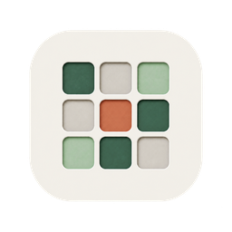
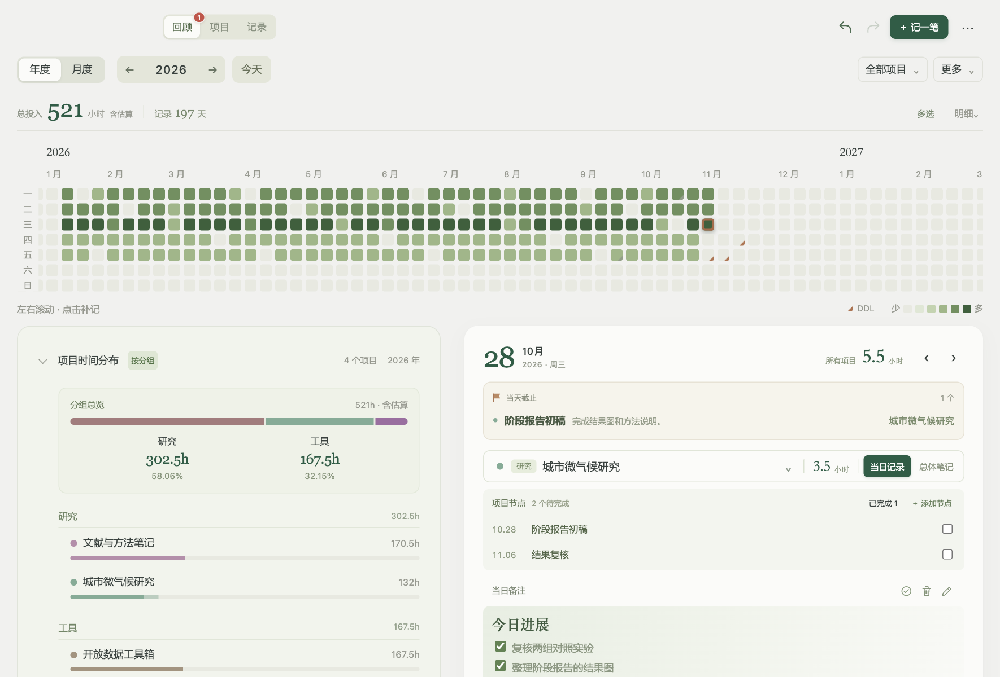
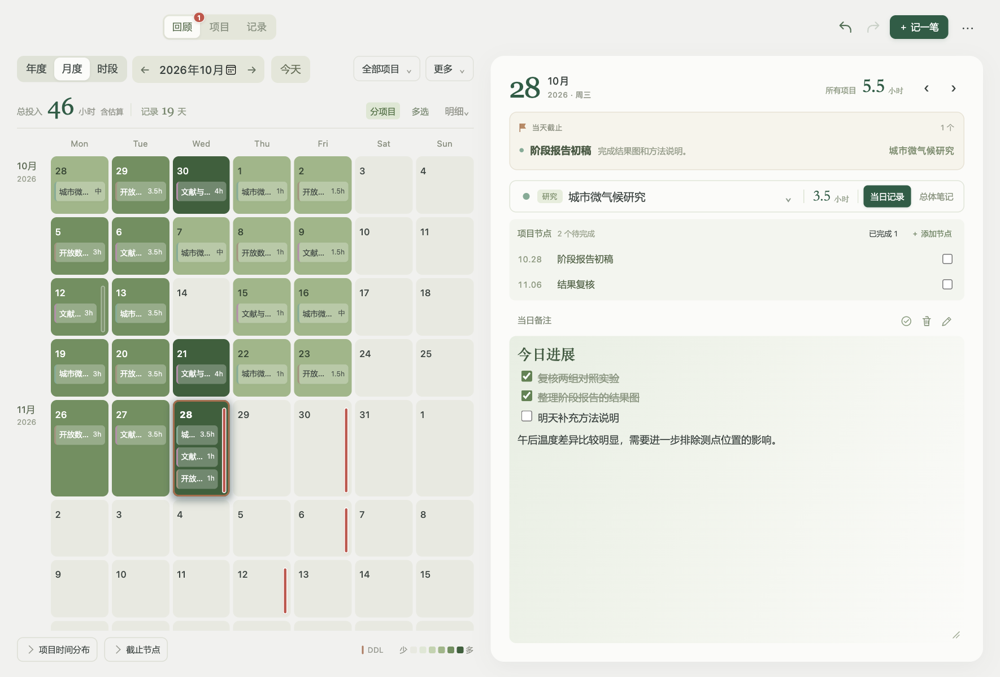
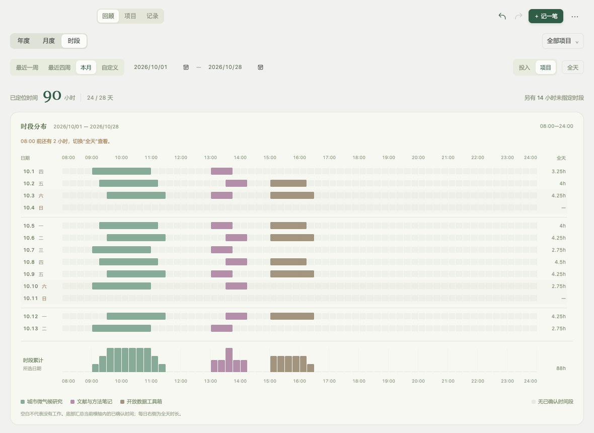
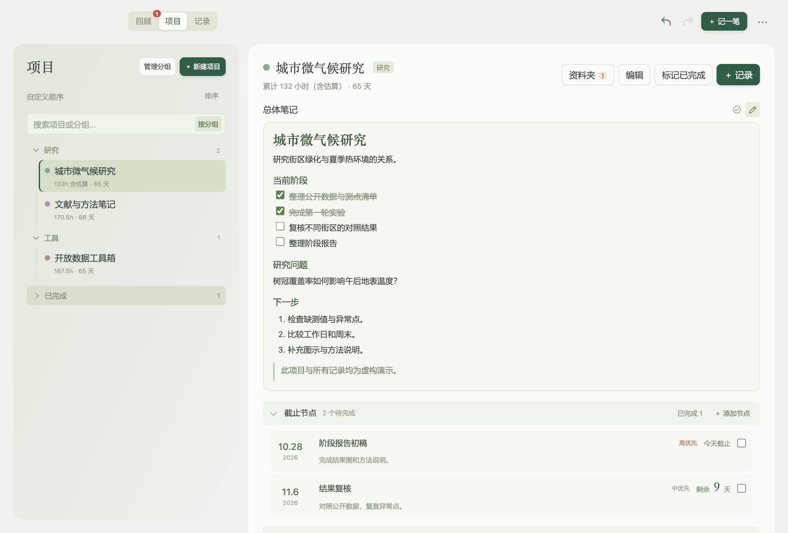
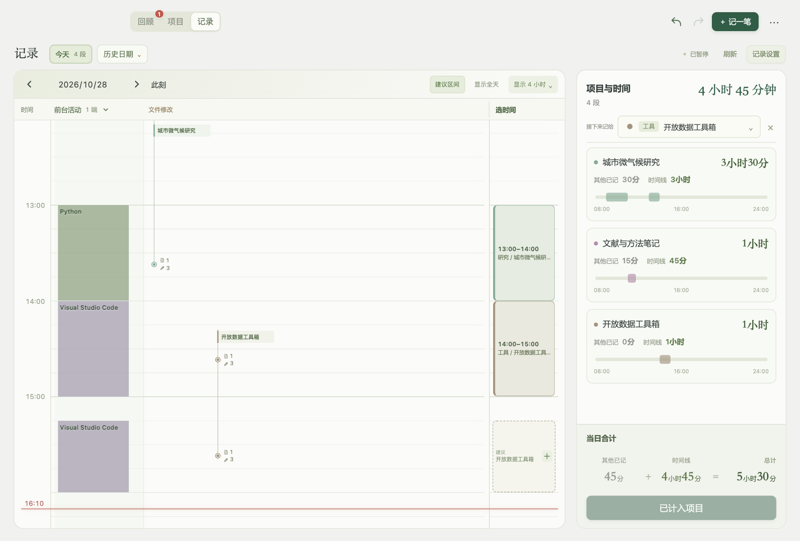
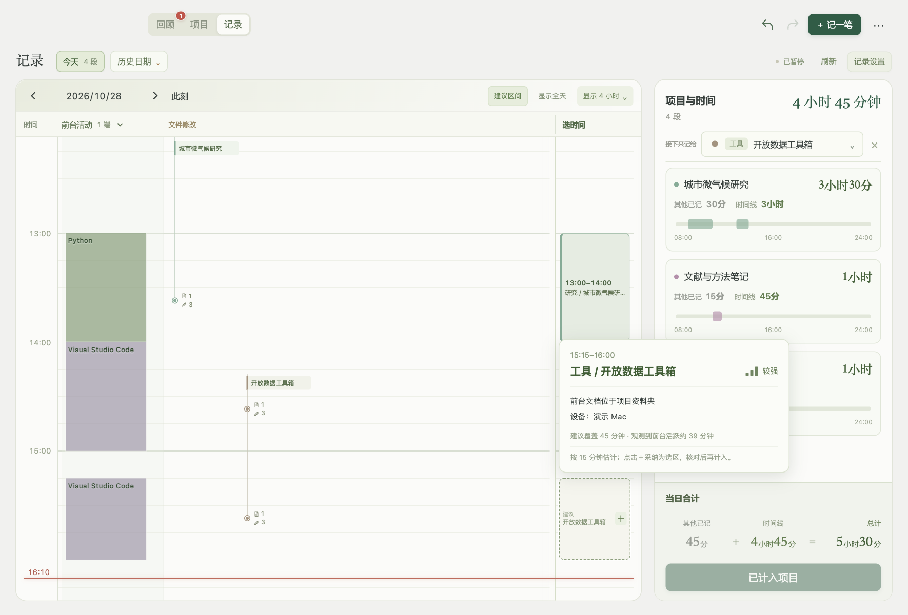

<p align="center"></p>
<h1 align="center">Project Journal · 项目手记</h1>
<p align="center">Local project notes, time records and work reviews.</p>
<p align="center"><a href="https://github.com/TianyiSongZJU/project-journal/releases/latest">Download</a> · <a href="README.md">中文</a> · <a href="docs/development.md">Build & development</a></p>



Project Journal keeps project notes, daily progress, deadlines and time records in one place. You can enter notes and time directly, or use optional foreground activity and file-change clues to recall your work. Review suggested time blocks and confirm their project before adding them to your records.

This is an early desktop app for **macOS and Windows**, maintained by an individual. The interface is currently primarily in Chinese. It requires no account and provides no hosted service.

## What it does

- Projects and groups, Markdown project notes, daily entries, deadlines and completed-project archives.
- A daily timeline for allocating time in 15-minute increments. Other manually entered time is recorded separately.
- Optional foreground activity and folder-change collection. Suggested time blocks include their evidence and device sources.
- Annual and monthly heatmaps, time-of-day review, project/group distributions, and hours/days display in the annual review.
- Local JSON storage partitioned by project, month and device; history recovery, sync-copy warnings and folder relocation.
- Restores the previous view and display preferences. macOS has a menu-bar app and background-only login startup.

**Activity clues do not measure work time.** Suggestions help you recall your day and require review and confirmation before they count toward project time. If evidence from multiple devices points to different projects, you need to decide where the time belongs.

## Screenshots

All screenshots use reproducible, fictional sample data. They contain no real user notes or activity logs and show the desktop content area without the native window title bar.

**Monthly review and daily progress**



**Time-of-day review**

Compare dates in 15-minute increments, using an 08:00–24:00 axis or a full-day view. Filter by date and project, switch between effort and project colors, and inspect cumulative time by time of day. Only confirmed allocations are included; daily totals without timestamps remain separate.

This feature is available on the main branch for local builds. The existing 2.1.0 download does not include it yet.



**Project notes, deadlines and daily entries**



**Activity clues, file changes and time blocks**



**Inspect the evidence behind a suggestion**



## Download and run

Download a ZIP from [Releases](https://github.com/TianyiSongZJU/project-journal/releases/latest), rather than the automatically generated source archives.

| Platform | Package | Requirements |
| --- | --- | --- |
| macOS | project-journal-macos-universal.zip | macOS 13+, Apple Silicon or Intel |
| Windows | project-journal-windows-x64.zip | Windows x64, Microsoft WebView2 Runtime |

Extract the full package to a writable, permanent folder. On Mac, open 项目手记.app; on Windows, run 项目手记-Windows.exe. Keep the license materials provided with the download.

The Mac app is ad-hoc signed and has not been notarized by Apple. Windows builds do not have a paid code-signing certificate. Your OS may require explicit approval. Verify the download source before approving it. If WebView2 is missing, install it from [Microsoft](https://developer.microsoft.com/microsoft-edge/webview2/).

The Mac universal build has been built and signature-verified locally. The Windows version is cross-compiled and has not been tested on a Windows device. Compatibility reports from Windows users are welcome.

## First steps

1. In 项目 (Projects), create a project and write its goal or next steps.
2. Use 记一笔 (New entry) to record progress and time. A note without time is fine.
3. Optionally enable foreground activity or bind a project folder under 记录 → 记录设置 (Record → Settings).
4. In 记录 (Record), select or adopt suggested time blocks, assign projects, review, then choose 计入项目 (Apply).
5. Use 回顾 (Review) to explore monthly/annual work and deadlines.

Monitoring is optional. Access to window titles depends on OS permissions, including macOS Accessibility permissions. File watching records metadata without reading document contents. The app does not record screenshots, keystroke contents, audio or video. Once an idle period exceeds the configured threshold, that idle time is deducted retrospectively. Computer activity may still differ from actual work.

## Your data

The app stores records in a sibling data/ folder. Keep the entire folder, including .english-layout, notes/, time/, activity/, history-content/ and backups/. Older installations may use a legacy layout. Do not manually rename files referenced by old indexes.

To share records between Mac and Windows, sync **all of data/** with your own sync tool. The app has no built-in cloud service. Source documents are stored separately, so bind their local folder on each device. Keep local preferences, monitoring settings and absolute folder paths specific to each device.

Finish saving and syncing on one device before editing on the next. The app checks revisions, warns about conflict copies and merges activity clues. These measures do not guarantee conflict-free real-time editing through every file-sync service. Keep independent backups. Local files are not encrypted. When updating, preserve your data and device settings and replace only the application files.

More details: [data and privacy](docs/privacy.md) (Chinese).

## Run the sample data

The generator refuses to overwrite an existing output directory. Run the demo in a new directory and keep it separate from your own journal.

```sh
python3 scripts/make-demo.py --output /tmp/project-journal-demo
cd src
go run . --ui-only --no-open --data-dir /tmp/project-journal-demo/data --auto-home /tmp/project-journal-demo/local
```

Open the session URL printed by the server and select **2026-10-28**. The demo has no folder bindings and monitoring is disabled.

## Build

Requires Go 1.24 or compatible. The Mac shell also requires Xcode Command Line Tools. Runtime Go dependencies are vendored.

```sh
git clone https://github.com/TianyiSongZJU/project-journal.git
cd project-journal
./scripts/build-macos.sh
# Or cross-compile Windows with: ./scripts/build-windows.sh
cd src
go test ./...
node --test tests/*.test.js
```

See [development notes](docs/development.md) for screenshots and license packaging. Do not commit personal data or logs.

## Contribute and license

When reporting an issue, include the OS and app version, steps to reproduce it, and the expected and actual behavior. Use fictional data. See [CONTRIBUTING](CONTRIBUTING.md) and [SECURITY](SECURITY.md).

Project code is [MIT licensed](LICENSE). Dependencies retain their respective terms in [THIRD_PARTY_NOTICES](THIRD_PARTY_NOTICES.md). The app icon was created with generative assistance; prompts and edit history are documented in assets/icons/设计说明.md.
